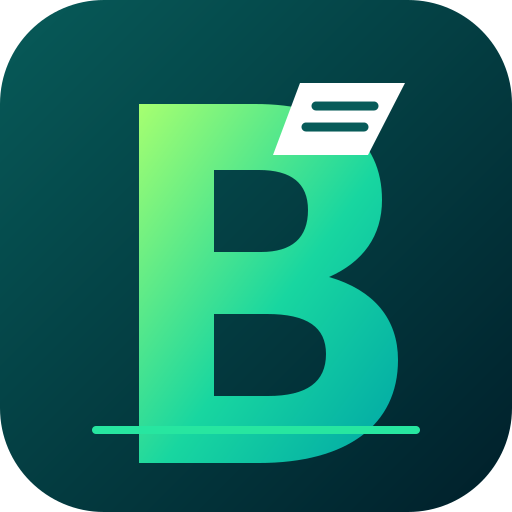

# Billit

Billit is a Flutter-based point-of-sale (POS) and retail-management application. It provides local business data management, billing, inventory, GST support, sales and expense reporting, employee payroll, PDF invoices, thermal printing, Google Drive backup/restore, barcode workflows, and optional WhatsApp invoice delivery.



> **Important:** Billit stores its operational data locally using Hive. Google Drive is used for backup/restore; it is not a live multi-device database or real-time synchronisation service. Keep independent backups and test restore procedures before relying on them.

## Contents

- [Feature overview](#feature-overview)
- [Technology stack](#technology-stack)
- [Requirements](#requirements)
- [Clone and run](#clone-and-run)
- [Build Billit for Windows](#build-billit-for-windows)
- [Configure Google Drive backup on Windows](#configure-google-drive-backup-on-windows)
- [Google Drive backup behaviour](#google-drive-backup-behaviour)
- [WhatsApp invoice delivery](#whatsapp-invoice-delivery)
- [Build for Android and Web](#build-for-android-and-web)
- [Default accounts and roles](#default-accounts-and-roles)
- [Data storage and backup safety](#data-storage-and-backup-safety)
- [Development workflow](#development-workflow)
- [Project structure](#project-structure)
- [Troubleshooting](#troubleshooting)
- [Security and production checklist](#security-and-production-checklist)

## Feature overview

### 1. Billing and invoice management

- Search the product catalogue and add products to the cart.
- Scan product barcodes using a supported camera scanner, a USB/Bluetooth keyboard-wedge scanner, or manual barcode entry.
- Validate available stock before adding quantities to a sale.
- Support product quantities measured in pieces (`pcs`), kilograms (`kg`), and square feet (`sqft`).
- Enter customer name and phone number, apply discounts, and select Cash, Card, or UPI as the payment method.
- Calculate sale totals, product cost, and profit; complete a sale to save the invoice and update stock.
- Configure invoice numbering with a prefix and next invoice number.
- Configure business details, GSTIN, invoice accent, footer text, business logo, and UPI payment details.
- Generate invoice PDFs, share them, and print receipts where the selected platform and printer support the required workflow.
- Browse invoice history and access invoice actions, including editing/deleting supported records and PDF/print actions.
- Look up customers by name or phone number and inspect their previous invoices.
- Generate UPI payment QR information from the configured UPI ID/payee details where enabled.

### 2. Product and inventory management

- Create, edit, and manage products with name, selling price, cost price, stock, category, subcategory, unit, HSN information, and barcode data.
- Search by product name, category, subcategory, HSN code, or barcode.
- Filter inventory by category, subcategory, and unit.
- Switch between supported list and grid product views.
- Track active products and stock availability.
- Import multiple products from an Excel workbook using the bulk product import workflow. Review the spreadsheet columns and validate the import before using it for a live inventory.

### 3. Sales reporting

- Review daily sales summaries.
- Admin users can access monthly and yearly reporting periods where available.
- Navigate between reporting periods.
- Review revenue, profit, and invoice counts.
- Browse sales records and access invoice-related actions from report views.

### 4. GST, exports, and statements

- Configure business GST details and GST settings.
- Maintain product-level HSN/GST information where configured.
- Access GST exports and business statements from **Archive → Reports & Statements**.
- Generate day-wise sales statements or statements for a selected date range.
- Export supported reports in PDF format.
- Use the available sales, item, GST, and expense register export workflows.
- Verify GST rates, inclusive/exclusive pricing settings, business GSTIN, and report totals before submitting exported documents for statutory or accounting use. Billit does not replace review by a qualified tax professional.

### 5. Expenses and employee payroll

- Record business expenses with amount, description, date, and category.
- Use built-in categories such as rent, utilities, transport, supplies, maintenance, and miscellaneous, and add categories as supported by the app.
- Browse expense history by day, month, or year.
- Filter salary expenses separately from other expenses where available.
- Add employees as daily-wage or monthly-salary staff.
- Set and edit employee pay type and pay amount; remove employee records when required.
- Record daily wage payments and monthly salary payments.
- Review employee/payment summaries for the current day or month.
- Review payroll and expense totals by day, month, or year, including daily wages, monthly salaries, other expenses, and net expenses.

### 6. Archive and administration

The Archive area groups business administration tools into categories:

- **Financial Management:** record and browse business expenses.
- **Human Resources:** employee records, daily wage payments, and monthly salary payments.
- **Product Management:** Excel bulk product import.
- **Reports & Statements:** sales statements, GST exports, item registers, and expense exports.
- **Data Management:** Google Drive backup and restore.
- **Account & Settings:** password management and customer lookup.

Access to Archive tools is role-dependent. See [Default accounts and roles](#default-accounts-and-roles).

### 7. Google Drive backup and restore

- Sign in to a Google account and upload JSON backups of Billit business data to Google Drive.
- Store backups in a Drive folder named **Billit**. The service can rename the legacy **FloralBillingBackups** folder to **Billit** so existing backups in that folder remain available.
- List available backups, view file metadata, and restore a selected backup.
- The Drive integration uses the restricted `drive.file` scope rather than unrestricted access to the user's entire Drive.
- The Windows desktop build uses a dedicated OAuth 2.0 authorization-code flow with PKCE and a loopback redirect.
- The Google Drive backup feature is separate from the local Hive database. A successful backup is an uploaded snapshot, not continuous synchronisation.

Restoring a backup replaces local business data. Confirm the selected backup and create a fresh backup before restoring.

### 8. Thermal printer and receipt workflows

- Discover/select supported Bluetooth printer devices through the platform printer plugins.
- Configure a default thermal printer where supported.
- Generate ESC/POS receipt output using the configured paper width and printer workflow.
- Prepare business logos for common 58 mm and 80 mm thermal receipt widths.
- Printer availability depends on the operating system, printer model, connection type, driver/plugin support, and permissions. Test with the actual printer before using the workflow at a checkout counter.

### 9. Application settings and interface

- Configure app name, app logo, business name, address, phone, email, GSTIN, invoice prefix, and invoice numbering.
- Configure invoice logo, footer, accent colour, UPI ID, payee name, and payment note prefix.
- Configure supported appearance options, including theme, light/dark/system mode, UI density, product view, navigation style, text scale, corner radius, and other presentation settings.
- Access in-app Help and FAQ content.
- Change the admin account password.

### 10. WhatsApp invoice delivery (optional backend)

- Send generated invoice PDFs from Invoice History through Meta's official WhatsApp Business Cloud API.
- Keep the Meta access token on a separate Node.js backend, not in the Flutter application.
- Configure the backend URL and shared Billit API key in **App & Invoice Settings → WhatsApp Cloud API**.
- Use an approved WhatsApp utility template for business-initiated messages outside the customer-service window.

See [WhatsApp invoice delivery](#whatsapp-invoice-delivery) for setup and policy constraints.

## Technology stack

| Area | Technology |
| --- | --- |
| Application | Flutter / Dart |
| State and app architecture | Provider and Flutter widgets |
| Local persistence | Hive / Hive Flutter |
| PDF generation and printing | `pdf`, `printing`, ESC/POS-related packages |
| Thermal printer integration | `print_bluetooth_thermal`, `flutter_thermal_printer`, `esc_pos_utils_plus` |
| Google authentication and Drive | `google_sign_in`, Google APIs, Windows OAuth PKCE implementation |
| Secure credential storage | `flutter_secure_storage` |
| Barcode scanning | `mobile_scanner` plus supported external scanner input |
| Excel import | `excel`, `file_picker` |
| QR generation | `qr` |
| Optional WhatsApp backend | Node.js 20+, Express, Meta WhatsApp Business Cloud API |

The exact dependency versions are defined in `pubspec.yaml` and `pubspec.lock`. Use the lockfile and the Flutter/Dart versions compatible with the project rather than independently upgrading packages during a release build.

## Requirements

### Common

- Git.
- Flutter SDK on the stable channel.
- Dart SDK version allowed by `pubspec.yaml` (`>=3.6.0 <4.0.0`).
- Internet access for dependency installation and services such as Google Drive/WhatsApp.
- A supported development platform and the platform-specific toolchain.

### Windows desktop build

- Windows 10 or Windows 11, 64-bit.
- Visual Studio 2022 (not Visual Studio Code alone).
- Visual Studio workload **Desktop development with C++**.
- MSVC C++ build tools, Windows 10/11 SDK, and CMake tools selected in the Visual Studio Installer.
- Flutter Windows desktop support enabled.
- Google OAuth Desktop client ID if Windows Google Drive sign-in is required.

Visual Studio Code is an editor; it does not replace Visual Studio's C++ compiler/toolchain.

## Clone and run

1. Clone the repository and enter the project directory:

   ```powershell
   git clone https://github.com/NaurasShaji/Billit.git
   cd Billit
   ```

2. Check the installed toolchain:

   ```powershell
   flutter --version
   dart --version
   flutter doctor -v
   ```

3. If Windows desktop development is the target, enable the desktop target:

   ```powershell
   flutter config --enable-windows-desktop
   flutter doctor -v
   ```

4. Install the locked package dependencies:

   ```powershell
   flutter pub get
   ```

5. Run the app on a selected target:

   ```powershell
   # Windows desktop
   flutter run -d windows

   # Chrome / Flutter Web
   flutter run -d chrome

   # Android (replace with the device ID shown by flutter devices)
   flutter devices
   flutter run -d <device-id>
   ```

If Flutter reports that the Windows desktop toolchain is missing, resolve the Visual Studio/C++ workload issue shown by `flutter doctor -v` before trying to build again.

## Build Billit for Windows

### Step 1 — Install the Windows toolchain

1. Install Flutter for Windows and add Flutter's `bin` directory to your PATH.
2. Install Visual Studio 2022.
3. In Visual Studio Installer, select **Desktop development with C++**.
4. Confirm that the workload includes:
   - MSVC v143 (or the compiler version required by your installed Visual Studio release).
   - Windows 10/11 SDK.
   - C++ CMake tools for Windows.
   - Ninja/CMake components where offered.
5. Open a new PowerShell window and run:

   ```powershell
   flutter doctor -v
   flutter devices
   ```

6. Confirm that Visual Studio is detected and that Windows appears as an available device.

### Step 2 — Prepare the project

From the repository root:

```powershell
flutter clean
flutter pub get
```

If generated files or plugin registration are stale, Flutter regenerates the Windows plugin/build files during the next build. Do not manually edit generated files under `windows/flutter/ephemeral/`.

### Step 3 — Configure Google Drive before building (if required)

Follow [Configure Google Drive backup on Windows](#configure-google-drive-backup-on-windows) and obtain the OAuth Desktop client ID. The Windows OAuth implementation reads compile-time Dart defines. If you omit the client ID, the rest of Billit can build, but interactive Google Drive sign-in on Windows will report that the Windows Drive integration is not configured.

### Step 4 — Build a release bundle

**Without Google Drive OAuth configured:**

```powershell
flutter build windows --release
```

**With Google Drive OAuth configured:**

```powershell
flutter build windows --release --dart-define=GOOGLE_DESKTOP_CLIENT_ID=YOUR_DESKTOP_CLIENT_ID
```

If your Google OAuth Desktop client configuration explicitly requires a client secret, pass it as a second define:

```powershell
flutter build windows --release `
  --dart-define=GOOGLE_DESKTOP_CLIENT_ID=YOUR_DESKTOP_CLIENT_ID `
  --dart-define=GOOGLE_DESKTOP_CLIENT_SECRET=YOUR_DESKTOP_CLIENT_SECRET
```

Do not put real client credentials in source files, commit them to Git, or paste them into issue reports. Treat build logs and CI command histories as potentially visible. For a desktop OAuth client, Google generally treats the client as a public client; a client secret embedded in a desktop executable cannot be kept confidential. PKCE is the key protection in this implementation.

### Step 5 — Locate the Windows application

After a successful release build, the distributable folder is:

```text
build\windows\x64\runner\Release\
```

The folder contains `Billit.exe`, Flutter runtime files, plugin DLLs, and the `data` directory. **Distribute the entire Release folder**, not just `Billit.exe`. The executable depends on the adjacent runtime DLLs and data files.

You can copy the complete folder to another compatible 64-bit Windows machine and run `Billit.exe`. The target machine does not need the Flutter SDK, but it may need the supported Microsoft Visual C++ runtime if it is not already installed.

For a convenient distribution package, zip the entire Release directory:

```powershell
Compress-Archive -Path .\build\windows\x64\runner\Release\* -DestinationPath .\Billit-Windows-x64.zip -Force
```

This creates a portable folder/ZIP distribution. It does not create an MSI or signed installer. Use an installer-authoring/signing process separately if you need installation shortcuts, uninstallation, automatic updates, or enterprise deployment.

### Step 6 — Test the release build

Before sharing the build, test it on a clean Windows user account or another Windows PC:

- App launches and displays the Billit window and icon.
- Admin/worker login and role-specific navigation work.
- Product creation, editing, stock updates, and sales work.
- Invoice PDF generation and file saving work.
- Excel import and report exports work.
- Google Drive sign-in, upload, backup listing, download, and restore work if configured.
- Printer discovery/printing works with the actual target printer and driver.
- USB barcode scanner input works; camera scanning may not be supported on Windows.
- Re-launching the app preserves local data.

Do not assume that a successful compilation proves that Google OAuth, printing, or backup/restore works on a different Windows computer.

## Configure Google Drive backup on Windows

Windows uses a custom OAuth 2.0 authorization-code flow with Proof Key for Code Exchange (PKCE), implemented in `lib/services/windows_google_drive_auth.dart`. The app opens the system browser, listens on a temporary localhost callback port, exchanges the authorization code for tokens, and stores tokens using Flutter Secure Storage.

### Step 1 — Create or select a Google Cloud project

1. Open the [Google Cloud Console](https://console.cloud.google.com/).
2. Create a project for Billit or select an existing project.
3. Keep a note of the project name so the OAuth client and API configuration are created in the same project.

### Step 2 — Enable the Google Drive API

1. In Google Cloud Console, open **APIs & Services → Library**.
2. Search for **Google Drive API**.
3. Open it and select **Enable**.
4. Confirm that the API is enabled in the same Cloud project used for the OAuth consent configuration.

The app uses the Drive API to create/find the Billit backup folder, upload JSON backup files, list backup files, and download a selected backup.

### Step 3 — Configure the OAuth consent screen / Google Auth Platform

Google's console labels may change, but configure the OAuth consent/app branding and audience for the project:

1. Set the application name to Billit and provide the required support/developer contact details.
2. Select the appropriate audience:
   - **External** if ordinary Google accounts outside your Workspace organisation will connect.
   - **Internal** only if the app is restricted to accounts in your Google Workspace organisation.
3. If the app is in **Testing** mode, add every Google account that will test Drive backup as a test user.
4. Configure the requested scopes. The Windows implementation requests:
   - `https://www.googleapis.com/auth/drive.file`
   - `openid`
   - `email`
5. Complete any verification/publishing requirements Google presents before distributing the application broadly.

The `drive.file` scope is intentionally narrower than full Drive access. It allows the app to create and manage files it creates or files the user explicitly opens with the app; it does not grant unrestricted access to every file in the user's Drive.

### Step 4 — Create an OAuth Desktop application client

1. In Google Cloud Console, open **Google Auth Platform → Clients** (or **APIs & Services → Credentials**, depending on the console layout).
2. Select **Create client**.
3. Choose **Desktop app** as the application type.
4. Give the client a recognisable name, such as `Billit Windows Desktop`.
5. Create the client and copy the **Client ID**.
6. Keep the client ID available for the Windows build command.

The Windows implementation uses a dynamic loopback redirect URI of the form `http://127.0.0.1:<temporary-port>/oauth2callback`. It binds a local listener to an available port at sign-in time; do not replace this with a hard-coded production web redirect URI.

### Step 5 — Build with the Desktop Client ID

From the Billit project root:

```powershell
flutter pub get
flutter build windows --release --dart-define=GOOGLE_DESKTOP_CLIENT_ID=YOUR_DESKTOP_CLIENT_ID
```

Replace `YOUR_DESKTOP_CLIENT_ID` with the complete value from the Google Cloud Console. Do not include angle brackets or quotes around the value.

For local debugging:

```powershell
flutter run -d windows --dart-define=GOOGLE_DESKTOP_CLIENT_ID=YOUR_DESKTOP_CLIENT_ID
```

The optional `GOOGLE_DESKTOP_CLIENT_SECRET` define is supported by the code, but a secret embedded in a desktop application is not confidential. Prefer the Desktop OAuth client and PKCE flow; do not rely on a packaged secret as a security boundary.

**Important:** Dart defines are compile-time values. Adding the client ID to a terminal command does not persist it in your project. You must include it again for every build/run command, or configure your own private build script/CI secret handling. Never commit a real secret-bearing script.

### Step 6 — Sign in from Billit

1. Launch the Windows build.
2. Open the app's Backup & Restore screen.
3. Choose the Google Drive sign-in/connect action.
4. Billit opens the default browser.
5. Sign in with a Google account permitted by the OAuth consent-screen audience and testing/publishing status.
6. Review and approve the requested Drive file access.
7. After Google redirects to the temporary localhost callback, the browser displays a confirmation page. Close the browser tab and return to Billit.
8. Create a backup and confirm that it appears in the backup list.

If the browser sign-in is successful but the callback does not return to Billit, check local firewall/security software and ensure that the app is allowed to bind to localhost. The callback uses loopback on the same Windows computer.

### Step 7 — Understand token storage and account changes

- Windows OAuth access and refresh tokens are stored through Flutter Secure Storage, not in the Hive business-data boxes.
- Access tokens are refreshed when needed using the stored refresh token.
- Signing out revokes the refresh token where possible and clears the locally stored token/account values.
- A Google OAuth consent-screen change, revoked permission, expired/revoked refresh token, or account security event may require the user to reconnect.
- If Google marks the app as testing, refresh-token lifetime and user access may be subject to Google's testing-mode restrictions. Publish/configure the OAuth app appropriately before relying on long-term use.

### Google Drive setup troubleshooting

| Symptom | Checks |
| --- | --- |
| “Windows Google Drive is not configured” | Rebuild with `--dart-define=GOOGLE_DESKTOP_CLIENT_ID=...`. |
| Access blocked / app not verified | Check OAuth audience, test-user list, requested scopes, and Google publishing/verification status. |
| Drive API disabled | Enable Google Drive API in the same Cloud project as the OAuth client. |
| Browser opens but sign-in fails | Check client ID, consent-screen configuration, account eligibility, and internet access. |
| Browser says connected but Billit does not resume | Check localhost/loopback access and firewall/security software. |
| Backup list is empty | Confirm the signed-in Google account and check its Drive for the **Billit** folder. |
| Permission or token errors | Sign out from Billit, reconnect the Google account, and retry. |
| Backup restore fails | Confirm the selected backup is a Billit JSON backup and do not delete local data while troubleshooting. |

## Google Drive backup behaviour

- The backup service creates a Drive folder named `Billit`.
- If the legacy folder `FloralBillingBackups` exists and the new folder does not, the service renames the legacy folder rather than starting a separate empty folder.
- Backups are JSON files uploaded to the Billit folder.
- The app lists files by modification time and downloads a selected file before parsing/restoring it.
- Windows uses the custom PKCE OAuth service. Other platforms use the `google_sign_in` plugin path; their OAuth platform configuration may differ.
- Automatic sign-in is attempted on startup when the app's Drive auto-sync setting is enabled. This is an authentication/session convenience and should not be interpreted as proof that every local edit is continuously uploaded.
- Keep more than one backup and verify a restore on a test installation before deleting or replacing business data.

## WhatsApp invoice delivery

Billit can send invoice PDFs to customers using Meta's official WhatsApp Business Cloud API. This integration requires a separately deployed backend in `backend/whatsapp-api/`; the Flutter app does not call Meta using a long-lived Meta token.

### What is included

- Invoice History action to send the generated invoice PDF to the customer's saved phone number.
- Backend URL and Billit API key configuration under **App & Invoice Settings → WhatsApp Cloud API**.
- API key storage through Flutter Secure Storage.
- Node.js/Express backend endpoint that accepts a PDF, uploads it to Meta WhatsApp media storage, and sends it as a document message.
- API-key authentication, a 15 MB PDF upload limit, request rate limiting, configurable CORS, and HTTPS validation in non-debug Flutter builds.
- Optional approved WhatsApp utility-template mode.

### Meta account prerequisites

1. Create a Meta developer app and add the WhatsApp product.
2. Connect a WhatsApp Business Account (WABA).
3. Register/configure a WhatsApp sender phone number.
4. Obtain the sender's **Phone Number ID**.
5. Create a long-lived/system-user access token with the `whatsapp_business_messaging` permission.
6. While using a Meta test sender, add the recipient number as an allowed test recipient.
7. Follow WhatsApp's current opt-in, template, and messaging policies.

Official documentation: https://developers.facebook.com/documentation/business-messaging/whatsapp/

### Configure and run the backend

Use Node.js 20 or newer:

```powershell
cd backend/whatsapp-api
Copy-Item .env.example .env
```

Edit `.env` and set:

| Variable | Purpose |
| --- | --- |
| `PORT` | HTTP port; defaults to `8080`. |
| `BILLIT_API_KEY` | Long, random shared key entered in Billit settings. |
| `META_ACCESS_TOKEN` | Meta access token; backend only. |
| `META_PHONE_NUMBER_ID` | Registered WhatsApp sender Phone Number ID. |
| `META_GRAPH_API_VERSION` | Graph API version; example defaults to `v26.0`. |
| `WHATSAPP_INVOICE_TEMPLATE_NAME` | Optional exact name of an approved utility template. |
| `WHATSAPP_INVOICE_TEMPLATE_LANGUAGE` | Optional template language code; defaults to `en`. |
| `CORS_ORIGIN` | Optional comma-separated allowed origins for browser clients. |

Install and start:

```powershell
npm install
npm start
```

The service exposes `GET /health` for a health check. Deploy it behind HTTPS before using it from a production Billit installation.

### Configure Billit

1. Open **App & Invoice Settings → WhatsApp Cloud API**.
2. Enter the deployed backend base URL, without the `/api/whatsapp/send-invoice` suffix.
3. Enter the same value configured as `BILLIT_API_KEY` on the backend.
4. Save settings.
5. Ensure the customer has a valid phone number including the country code where required.
6. Open Invoice History and use the WhatsApp send action for the invoice.

The app assumes a 10-digit phone number is Indian and prefixes country code `91`. Other international numbers must include their country code.

### Message-window and template rules

- Free-form document messages are subject to WhatsApp's customer-service window, generally 24 hours after the customer last messages the business.
- To initiate a message outside that window, configure an approved WhatsApp utility template in Meta.
- The supported template must have a **document header** and three body placeholders in this order: customer name, invoice ID, and total amount.
- Set `WHATSAPP_INVOICE_TEMPLATE_NAME` and `WHATSAPP_INVOICE_TEMPLATE_LANGUAGE` to match the approved template exactly.
- Billit does not create, submit, or approve the template.
- A customer phone number alone does not establish permission to receive WhatsApp messages. Obtain and respect customer opt-in.

### API contract and current limitations

- `POST /api/whatsapp/send-invoice`
- Header: `x-billit-api-key: <BILLIT_API_KEY>`
- Multipart fields include `phone`, `invoiceId`, `customerName`, `totalAmount`, optional `caption`, and PDF file field `invoice`.
- PDF uploads are limited to 15 MB.
- The backend rate limit is 30 requests per IP per 15 minutes.
- A successful API response means Meta accepted the send request. It does **not** confirm delivery or that the customer read the message.
- Delivery/read receipts, inbound replies, webhook processing, automated retries, and per-business authentication/tenant isolation are not implemented in this version.
- The shared Billit API key is a basic backend gate, not robust per-user or per-business authentication. Add stronger authentication and tenant isolation before exposing the service to multiple businesses or a public production environment.

See [backend/whatsapp-api/README.md](backend/whatsapp-api/README.md) for backend-specific deployment details.

## Build for Android and Web

### Android APK

```powershell
flutter pub get
flutter build apk --release
```

The APK is produced under `build\app\outputs\flutter-apk\`. Android signing configuration is a separate release requirement; configure a private upload/release keystore before publishing to an app store. Do not commit signing keys or passwords.

### Flutter Web

```powershell
flutter pub get
flutter build web --release
```

The web output is generated under `build\web\`. Configure the hosting provider, HTTPS, allowed backend CORS origin (if using WhatsApp), and the appropriate Google authentication setup for the web target before deployment.

### Launcher icons

Android, Web, and macOS icon generation is configured in `pubspec.yaml` using `flutter_launcher_icons`. The Windows icon is maintained manually as `windows/runner/resources/app_icon.ico` and is referenced by `windows/runner/Runner.rc`.

After changing the source artwork or launcher icon configuration for the generated targets:

```powershell
flutter pub get
dart run flutter_launcher_icons
flutter clean
```

For Windows, replace/update the ICO resource deliberately and rebuild. Do not assume running `flutter_launcher_icons` updates the Windows icon: Windows generation is disabled in this repository's configuration.

## Default accounts and roles

A new local installation seeds the following accounts:

| Role | Username | Initial password |
| --- | --- | --- |
| Admin | `admin` | `admin123` |
| Worker | `worker` | `worker123` |

These are development/default credentials for a new local database. Change the admin password immediately. Do not use the defaults for a shared, public, or production installation.

- **Admin:** access to the Archive area and administrative functions, including expenses, payroll, backups, customer lookup, and account tools.
- **Worker:** access to Billing, Products, and Reports with daily reporting access.

The exact available screens/actions can change as the application evolves. Role checks in the application are the authority for actual access.

## Data storage and backup safety

- Business records are stored locally in Hive boxes.
- Hive model adapters and generated files are under `lib/models/`.
- Google Drive stores exported backup snapshots; it is not a shared database.
- A restore operation can replace local business data. Create a current backup first and verify the selected backup before confirming restore.
- Store backup copies in a second location where appropriate. A cloud account is not a substitute for a tested recovery plan.
- Do not share backup JSON files publicly; they can contain business and customer information.
- Windows Google OAuth credentials are stored using Flutter Secure Storage. WhatsApp API keys are also stored in secure storage on supported platforms.

## Development workflow

Install dependencies:

```powershell
flutter pub get
```

Run static analysis:

```powershell
flutter analyze
```

Run tests:

```powershell
flutter test
```

Regenerate Hive adapters after changing Hive model annotations/schema:

```powershell
dart run build_runner build --delete-conflicting-outputs
```

When changing a Hive model, preserve existing type IDs and field indices. Changing them carelessly can make previously saved local data unreadable. Plan and test data migrations before shipping a model change.

For a clean Windows release build:

```powershell
flutter clean
flutter pub get
flutter analyze
flutter test
flutter build windows --release
```

The commands above are recommended checks; they are not a statement that these checks have already been run for every commit.

## Project structure

```text
Billit/
├── assets/
│   └── icon/                 App icon artwork
├── backend/
│   └── whatsapp-api/         Optional Node.js WhatsApp Cloud API backend
├── lib/
│   ├── models/               Hive data models and generated adapters
│   ├── screens/              Login, home, billing, product, archive and settings UI
│   ├── services/             Auth, Hive, Drive, PDF, printing and integration logic
│   ├── widgets/              Shared and responsive UI components
│   └── main.dart             Hive initialization and app entry point
├── test/                     Flutter tests
├── windows/
│   └── runner/               Windows desktop runner, icon and resources
├── pubspec.yaml              Flutter dependencies and asset configuration
└── README.md                 Project documentation
```

## Troubleshooting

### Flutter cannot find Visual Studio

Run `flutter doctor -v`. Install Visual Studio 2022 with **Desktop development with C++**, MSVC, Windows SDK, and CMake tools. Restart the terminal after installation.

### Windows build fails after switching branches or dependencies

Run:

```powershell
flutter clean
flutter pub get
flutter build windows --release
```

If the error identifies a specific plugin's Windows native dependency, check that plugin's supported Windows platform and toolchain requirements.

### Google Drive does not sign in on Windows

- Confirm the build includes `GOOGLE_DESKTOP_CLIENT_ID`.
- Confirm Google Drive API is enabled.
- Confirm the OAuth client type is **Desktop app**.
- Confirm the signed-in account is permitted by the OAuth consent-screen audience/test-user configuration.
- Check internet access and localhost callback access.
- Reconnect the Google account after revoking access or changing OAuth configuration.

### Google Drive works on one platform but not another

The Windows app uses `WindowsGoogleDriveAuth`; other platforms use `google_sign_in`. Each platform may require its own OAuth configuration. A Windows Desktop OAuth client ID is not a replacement for Android, iOS, or Web OAuth client configuration.

### Printer is not detected

Check Bluetooth pairing/connection, printer power, Windows device visibility, printer driver/plugin support, and paper width configuration. Test the printer with a minimal receipt before relying on it for live sales.

### Camera barcode scanner is unavailable

Camera scanning is platform-dependent. Use a supported camera device or an external USB/Bluetooth barcode scanner that sends keyboard input, or enter the barcode manually.

### WhatsApp send fails

Check the backend health endpoint, HTTPS URL, Billit API key, Meta token, Phone Number ID, recipient country code, template configuration, Meta test-recipient status, and the WhatsApp customer-service window. A successful backend response is not proof of delivery.

## Security and production checklist

Before deploying Billit in a real business:

- Change the default admin password.
- Configure and test a recovery/backup process.
- Protect exported backup files and customer/business data.
- Use a Google OAuth configuration appropriate for the intended users and distribution model.
- Do not commit OAuth secrets, Meta tokens, API keys, signing keys, or production credentials.
- Deploy the WhatsApp backend only over HTTPS and store Meta credentials in the hosting provider's secret manager.
- Replace the shared WhatsApp API key with stronger per-business authentication before a multi-tenant/public deployment.
- Obtain customer opt-in before sending WhatsApp messages.
- Test GST configuration and exported statements against the business's actual accounting requirements.
- Test the actual printer, barcode scanner, and Windows target machine.
- Sign and package Windows/Android releases using an appropriate distribution process.

---

## License

No license information is specified in this repository. Do not assume the code is open-source licensed for reuse until a license file is added.
